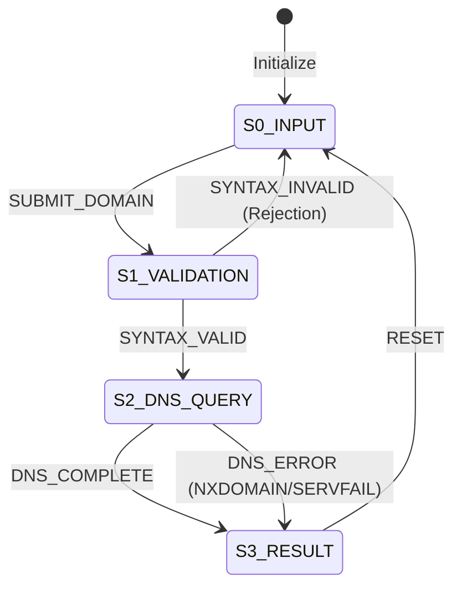

# NetDFA: Domain Name Validation and DNS Lookup System

> **Interdisciplinary College Project**  
> **Course Integrations**: Full Stack Web Development (FSWD) • Computer Networks (CN) • Formal Languages & Automata Theory (FLAT)  
> **Tech Stack**: React 18, Vite, Node.js, Express.js, MongoDB, Mongoose, Native OS DNS Resolver (`node:dns/promises`)

---

## 1. Project Introduction

**NetDFA** is a high-performance, transparent, and academically grounded web platform for domain name analysis and DNS record inspection. Traditional command-line utilities (such as `dig` or `nslookup`) often act as "black boxes" that obscure lexical validation, protocol states, and error disambiguation. 

This project bridges theoretical computer science and modern systems engineering by implementing:
1. **Chomsky Type-3 Regular Grammars** for domain syntax checking according to RFC 1034, 1035, and 1123.
2. A deterministic state machine controller modeled as a **Deterministic Finite Automaton (DFA)** $M = (Q, \Sigma, \delta, q_0, F)$ providing complete execution audit trails.
3. Parallel resolution of **6 DNS Resource Record (RR) types** (`A`, `AAAA`, `MX`, `NS`, `CNAME`, `TXT`) directly using the operating system's configured stub resolver via Node.js native `node:dns/promises`.
4. A production-ready Single Page Application (SPA) with a cybersecurity-inspired UI, real-time DFA telemetry, latency profiling, and persistent lookup history stored in MongoDB.

---

## 2. Problem Statement & Objectives

### Problem Statement
Standard DNS tools lack transparent visual feedback regarding lexical validity, failure modes, and automata state transitions. Furthermore, common web applications frequently confuse syntactic domain errors (such as invalid label formatting) with authoritative DNS resolution failures (such as `NXDOMAIN` or `ENODATA`), leading to unreliable networking diagnostics.

### Core Objectives
- **Academic Synthesis**: Seamlessly integrate Full Stack Web Development, Computer Networks, and Automata Theory into a unified, functional system.
- **Strict RFC Validation**: Enforce RFC 1034/1035 label length (1–63 octets), total length (≤253 octets), hyphen boundaries, and TLD constraints before triggering network traffic.
- **Deterministic State Modeling**: Construct a dedicated DFA controller that transitions deterministically between `INPUT`, `VALIDATION`, `DNS_QUERY`, and `RESULT` states, rejecting illegal state mutations.
- **Accurate Error Disambiguation**: Differentiate non-existent domains (`NXDOMAIN`) from existing domains lacking specific records (`ENODATA`), ensuring a domain is never marked invalid solely because one record type is absent.
- **Production Readiness**: Provide clean RESTful endpoints, rate limiting, responsive cybersecurity theming, centralized error handling, and robust database persistence with graceful offline fallback.

---

## 3. Technology Stack

| Layer | Technologies | Purpose |
|---|---|---|
| **Frontend** | React 18, Vite, React Router 6, Lucide Icons | Responsive UI, state management, real-time DFA visualization, client-side pre-validation. |
| **Backend** | Node.js (v24), Express.js | REST API gateway, rate limiting, centralized error handling, DFA controller engine. |
| **Networking** | Node.js native `node:dns/promises` | Direct interface to host OS resolver, concurrent resolution via `Promise.allSettled()`. |
| **Database** | MongoDB, Mongoose ODM | Schema validation, lookup history persistence, execution audit trails. |
| **Dev & Test** | Node Native Test Runner (`node:test`, `node:assert`) | Unit and end-to-end integration testing for regex rules, DFA states, and API endpoints. |

---

## 4. Academic Curriculum Integration

```mermaid
flowchart LR
    subgraph FLAT [Formal Languages & Automata Theory]
        FLAT1[Chomsky Type-3 Regex]
        FLAT2[DFA 5-Tuple Controller M]
        FLAT3[Transition Matrix Verification]
    end

    subgraph CN [Computer Networks]
        CN1[OS DNS Stub Resolver]
        CN2[Parallel RR Resolution: A, AAAA, MX, NS, CNAME, TXT]
        CN3[Error Taxonomy: NXDOMAIN vs ENODATA]
    end

    subgraph FSWD [Full Stack Web Development]
        FSWD1[React 18 + Vite SPA]
        FSWD2[Express REST API + Rate Limiter]
        FSWD3[MongoDB / Mongoose Persistence]
    end

    FLAT -->|Validates Input & Controls State| FSWD
    FSWD -->|Dispatches Network Queries| CN
    CN -->|Feeds Telemetry & Records| FSWD
```



### A. Formal Languages & Automata Theory (FLAT)
- **Regular Expressions**: Lexical verification that domain names belong to the regular language defined by RFC 1035.
- **DFA Formalization**: Formally specified 5-tuple $M = (Q, \Sigma, \delta, q_0, F)$ with 4 states, 6 alphabet symbols, a complete transition matrix, and strict rejection of illegal state changes.

### B. Computer Networks (CN)
- **Host Stub Resolver**: Utilizes the operating system's configured resolver rather than mocking responses or falsely claiming custom recursive implementation.
- **Asynchronous Concurrency**: Evaluates 6 resource record types simultaneously via `Promise.allSettled()`.
- **Accurate Disambiguation**: Correctly identifies when a domain exists but lacks a record (`ENODATA`), vs when the domain does not exist in authoritative roots (`NXDOMAIN`).

### C. Full Stack Web Development (FSWD)
- **Enterprise Architecture**: Decoupled client-server design with CORS policies, body size limits, rate limiting, and structured JSON payloads.
- **Resilient Persistence**: MongoDB stores execution time, record counts, and transition step logs. If MongoDB is offline, queries continue running in real-time with an explicit database status notification.

---

## 5. Formal DFA Specification

$$M = (Q, \Sigma, \delta, q_0, F)$$

- **States ($Q$)**:
  - $S_0$ = `INPUT` (Initial state)
  - $S_1$ = `VALIDATION` (Lexical analysis & RFC regex verification)
  - $S_2$ = `DNS_QUERY` (Parallel DNS stub resolution)
  - $S_3$ = `RESULT` (Accepting state, output synthesis, telemetry)
- **Alphabet ($\Sigma$)**:
  - `SUBMIT_DOMAIN`, `SYNTAX_VALID`, `SYNTAX_INVALID`, `DNS_COMPLETE`, `DNS_ERROR`, `RESET`
- **Initial State**: $q_0 = S_0$
- **Accepting State**: $F = \{ S_3 \}$

### State Transition Diagram



### State Transition Table

| Current State ($q$) | Input Symbol ($\sigma$) | Next State $\delta(q, \sigma)$ | Condition / Action |
|---|---|---|---|
| **$S_0$ (INPUT)** | `SUBMIT_DOMAIN` | **$S_1$** | User enters domain; triggers syntax validation. |
| **$S_1$ (VALIDATION)** | `SYNTAX_VALID` | **$S_2$** | Passes RFC 1035 regex and length checks; begins DNS query. |
| **$S_1$ (VALIDATION)** | `SYNTAX_INVALID` | **$S_0$** | Violates syntax; rejects input and resets to $S_0$ without network traffic. |
| **$S_2$ (DNS_QUERY)** | `DNS_COMPLETE` | **$S_3$** | OS resolver successfully answers query across RR types. |
| **$S_2$ (DNS_QUERY)** | `DNS_ERROR` | **$S_3$** | OS resolver returns NXDOMAIN or SERVFAIL (treated as valid result state). |
| **$S_3$ (RESULT)** | `RESET` | **$S_0$** | User initiates a new lookup cycle. |

---

## 6. Project Directory Layout

```text
Individual project/
├── backend/
│   ├── config/
│   │   └── db.js                 # MongoDB connection and status getter
│   ├── controllers/
│   │   └── dnsController.js      # REST API handlers for lookup and history
│   ├── middleware/
│   │   ├── errorHandler.js       # Centralized 404 & error handlers
│   │   └── rateLimiter.js        # Sliding-window IP rate limiter
│   ├── models/
│   │   └── LookupHistory.js      # Mongoose schema for lookup audit trail
│   ├── routes/
│   │   └── dnsRoutes.js          # Route definitions for /api/dns
│   ├── services/
│   │   ├── dfaController.js      # Formal FLAT DFA state machine
│   │   └── dnsService.js         # Native node:dns/promises resolver engine
│   ├── test/
│   │   ├── apiIntegration.test.js# Integration tests for all endpoints
│   │   ├── dfaController.test.js # DFA state machine tests
│   │   └── domainValidator.test.js# Regex and RFC domain validation tests
│   ├── utils/
│   │   └── domainValidator.js    # RFC 1034/1035 domain regex rules
│   ├── .env.example              # Environment variables template
│   ├── package.json              # Backend dependencies
│   └── server.js                 # Express server entrypoint
│
├── frontend/
│   ├── public/
│   │   └── logo.svg              # NetDFA vector shield icon
│   ├── src/
│   │   ├── components/
│   │   │   ├── DfaVisualizer.jsx # Interactive DFA node diagram & history log
│   │   │   ├── Footer.jsx        # Project academic footer
│   │   │   ├── Navbar.jsx        # Navigation bar with live server/DB badges
│   │   │   ├── RecordCard.jsx    # Individual DNS record card with copy action
│   │   │   └── StatusBadge.jsx   # Status indicator badge
│   │   ├── pages/
│   │   │   ├── History.jsx       # Past lookups table, detail modal, delete
│   │   │   ├── Home.jsx          # Dashboard with quick search & stats
│   │   │   ├── Theory.jsx        # Complete academic theory & transition table
│   │   │   └── Workbench.jsx     # Main lookup workbench & result cards
│   │   ├── services/
│   │   │   └── api.js            # REST client wrapper
│   │   ├── styles/
│   │   │   └── index.css         # Cybersecurity theme design tokens
│   │   ├── utils/
│   │   │   └── domainValidator.js# Client-side typing validation
│   │   ├── App.jsx               # Root routing
│   │   └── main.jsx              # Vite entrypoint
│   ├── .env.example              # Frontend environment template
│   ├── index.html                # HTML5 shell
│   ├── package.json              # Frontend dependencies
│   └── vite.config.js            # Vite configuration with API proxy
│
├── documentation/
│   ├── DFA_definition.md         # Formal mathematical DFA proof
│   ├── phase1_architecture_and_design.md # Architectural design document
│   ├── sample_inputs_outputs.md  # Detailed sample inputs and JSON responses
│   └── state_transition_table.md # Complete transition table and rules
│
├── README.md                     # Master documentation
└── .gitignore                    # Git exclusions
```

---

## 7. Installation and Execution Guide

### Prerequisites
- **Node.js**: v18.0.0 or higher (v24.x tested and recommended).
- **npm**: v9.0.0 or higher.
- **MongoDB** *(Optional)*: Local MongoDB instance or MongoDB Atlas connection string. (Application runs in real-time even if offline).

### Step 1: Install Backend Dependencies
```bash
cd backend
npm install
```

### Step 2: Configure Environment Variables
In the `backend/` directory, create a `.env` file (copied from `.env.example`):
```env
PORT=5000
NODE_ENV=development
MONGODB_URI=mongodb://127.0.0.1:27017/domain_dns_tool
CORS_ORIGIN=http://localhost:5173,http://127.0.0.1:5173
```

In the `frontend/` directory, create a `.env` file (copied from `.env.example`):
```env
VITE_API_BASE_URL=http://localhost:5000/api
```

### Step 3: Install Frontend Dependencies
```bash
cd ../frontend
npm install
```

### Step 4: Run the Backend Server
In a terminal:
```bash
cd backend
npm run dev
# Or: node server.js
```
The server will start on `http://localhost:5000`. Verify with `http://localhost:5000/api/health`.

### Step 5: Run the Frontend Application
In a separate terminal:
```bash
cd frontend
npm run dev
```
Open your browser to `http://localhost:5173`.

---

## 8. REST API Specification

### 1. `POST /api/dns/lookup`
Performs lexical validation, DFA state transitions, and concurrent DNS queries across 6 record types.
- **Body**: `{ "domain": "google.com" }`
- **Response (200 OK)**:
```json
{
  "success": true,
  "domain": "google.com",
  "isValidSyntax": true,
  "dnsStatus": "PARTIAL",
  "statusMessage": "Successfully resolved 5 record types. 1 record types are not published for this domain.",
  "executionTimeMs": 138.45,
  "records": {
    "A": ["142.251.106.100"],
    "AAAA": ["2404:6800:4007:836::200e"],
    "MX": [{ "exchange": "smtp.google.com", "priority": 10 }],
    "NS": ["ns1.google.com", "ns2.google.com"],
    "TXT": ["v=spf1 include:_spf.google.com ~all"]
  },
  "unavailableRecords": [
    { "type": "CNAME", "code": "ENODATA", "reason": "Domain exists, but no CNAME record is published (ENODATA)." }
  ],
  "dfaTransitions": [
    { "step": 1, "fromState": null, "toState": "S0", "symbol": "INITIALIZE", "timestamp": "..." },
    { "step": 2, "fromState": "S0", "toState": "S1", "symbol": "SUBMIT_DOMAIN", "timestamp": "..." },
    { "step": 3, "fromState": "S1", "toState": "S2", "symbol": "SYNTAX_VALID", "timestamp": "..." },
    { "step": 4, "fromState": "S2", "toState": "S3", "symbol": "DNS_COMPLETE", "timestamp": "..." }
  ],
  "currentState": { "code": "S3", "name": "RESULT", "isAccepting": true }
}
```

### 2. `GET /api/dns/history`
Retrieves chronological audit log of previous queries.
- **Query Params**: `?limit=50`
- **Response (200 OK)**: `{ "success": true, "count": 12, "data": [...] }`
- **Response if DB Disconnected (503 Service Unavailable)**:
```json
{
  "success": false,
  "error": "Database Unavailable",
  "message": "MongoDB is currently disconnected. History records cannot be retrieved."
}
```

### 3. `GET /api/dns/history/:id`
Retrieves a specific historical lookup record with complete persisted record and DFA details.

### 4. `DELETE /api/dns/history/:id`
Deletes a historical lookup record by ID.

### 5. `GET /api/health`
Returns system status, server uptime, database connection state, and OS DNS resolver details.

---

## 9. Comprehensive Test Suite

All unit and integration tests are executed using Node.js's native test runner (`node:test`).

To run all tests:
```bash
cd backend
npm test
```

### Test Coverage Highlights
- **19 Test Assertions**:
  1. Health check endpoint status and resolver verification.
  2. Happy path resolution for `google.com`, `amazon.in`, and `example.org`.
  3. Rejection of consecutive dots (`google..com`).
  4. Rejection of special characters (`google@com`).
  5. Rejection of leading hyphen (`-google.com`).
  6. Rejection of trailing hyphen (`google-.com`).
  7. Rejection of empty domain input (`""`).
  8. Accurate resolution failure handling for `example.invalid` (reporting `NXDOMAIN`, transitioning to $S_3$ Result state).
  9. Non-existent domain verification (`test-non-existent-12345-domain.xyz`).
  10. Clear 503 error handling when MongoDB is disconnected.
  11. DFA full lifecycle transitions ($S_0 \to S_1 \to S_2 \to S_3 \to S_0$).
  12. DFA syntax validation failure transitions ($S_0 \to S_1 \to S_0$).
  13. DFA DNS error transitions ($S_2 \to S_3$).
  14. DFA rejection of illegal transitions and symbols.
  15. RFC 1035 label max length (63 octets) and domain max length (253 octets).

---

## 10. Deployment Readiness

### Render (Backend)
- **Root Directory**: `backend`
- **Build Command**: `npm install`
- **Start Command**: `node server.js`
- **Environment Variables**:
  - `PORT`: `5000`
  - `MONGODB_URI`: `<Your MongoDB Atlas Connection String>`
  - `CORS_ORIGIN`: `https://your-frontend.vercel.app`

### Vercel (Frontend)
- **Root Directory**: `frontend`
- **Framework Preset**: `Vite`
- **Build Command**: `npm run build`
- **Output Directory**: `dist`
- **Environment Variables**:
  - `VITE_API_BASE_URL`: `https://your-backend.onrender.com/api`

---

## 11. Academic Assessment Summary

| Requirement | Implementation Detail | Academic Subject |
|---|---|---|
| **Domain Validation** | Implements RFC 1034/1035/1123 regular expression and programmatic label boundary checks. | **FLAT** |
| **Deterministic Automaton** | Formally defined 4-state DFA $M = (Q, \Sigma, \delta, q_0, F)$ with real-time UI state tracker and strict transition rejection. | **FLAT** |
| **Native DNS Resolution** | Concurrently queries A, AAAA, MX, NS, CNAME, and TXT records using OS resolver via `node:dns/promises`. | **CN** |
| **Error Taxonomy** | Disambiguates `NXDOMAIN` (domain does not exist) from `ENODATA` (domain exists without record type) and timeout errors. | **CN** |
| **RESTful Gateway** | Express.js API with sliding-window rate limiting, input sanitization, and centralized error handling. | **FSWD** |
| **Persistence Layer** | MongoDB + Mongoose schema storing audit trails, transition logs, and latency metrics with graceful offline degradation. | **FSWD** |
| **Cybersecurity UI** | Responsive, accessible dark interface with JetBrains Mono typography, interactive cards, and live DFA visualization. | **FSWD** |
