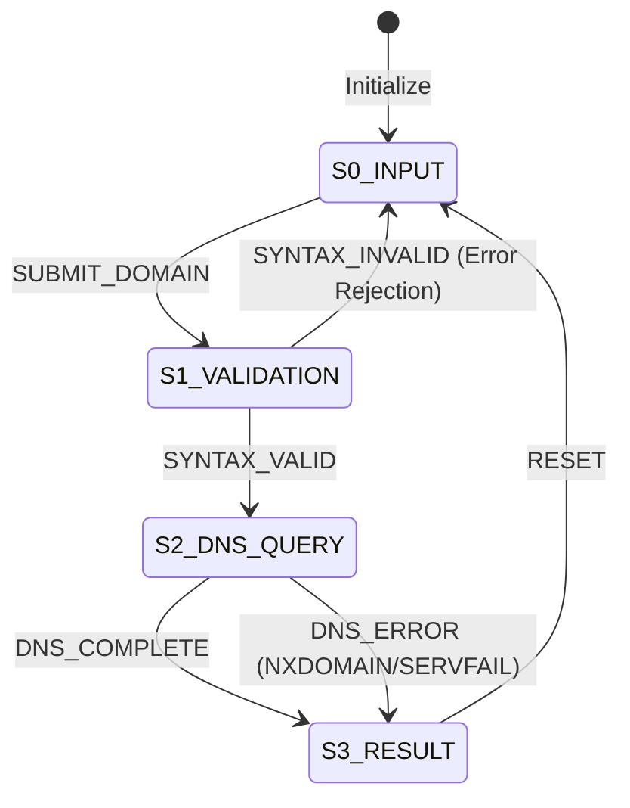

# Formal Definition of the Deterministic Finite Automaton (DFA)

**Project**: Domain Name Validation and DNS Lookup Tool  
**Discipline**: Formal Languages and Automata Theory (FLAT)  
**Standard**: Chomsky Hierarchy (Type-3 Regular Languages) & Deterministic Finite Automata  

---

## 1. Mathematical Formalism

In Formal Languages and Automata Theory, a **Deterministic Finite Automaton (DFA)** is formally defined as a 5-tuple:

$$M = (Q, \Sigma, \delta, q_0, F)$$

Where:
- $Q$ is a finite set of states.
- $\Sigma$ is a finite set of input symbols called the alphabet.
- $\delta: Q \times \Sigma \to Q$ is the state transition function.
- $q_0 \in Q$ is the designated initial state.
- $F \subseteq Q$ is the set of accepting (final) states.

---

## 2. Specification of 5-Tuple Components for NetDFA

### A. State Set ($Q$)
The automaton models the complete lifecycle of a domain query across four distinct, mutually exclusive states:

$$Q = \{ S_0, S_1, S_2, S_3 \}$$

| State | Identifier | Description | Semantic Role |
|---|---|---|---|
| $S_0$ | `INPUT` | Initial state awaiting user input. | Machine rests here waiting for a user query or after a reset. |
| $S_1$ | `VALIDATION` | Lexical and regular expression analysis. | Executes RFC 1035 regex and length validation checks. |
| $S_2$ | `DNS_QUERY` | Network DNS resolution. | Concurrently queries the OS resolver across 6 RR types via `Promise.allSettled()`. |
| $S_3$ | `RESULT` | Output synthesis and accepting state. | Synthesizes records, measures query latency, logs audit trail into MongoDB. |

### B. Input Alphabet ($\Sigma$)
The set of discrete transition events / trigger symbols generated by the client and backend engine:

$$\Sigma = \{ \text{SUBMIT\_DOMAIN}, \text{SYNTAX\_VALID}, \text{SYNTAX\_INVALID}, \text{DNS\_COMPLETE}, \text{DNS\_ERROR}, \text{RESET} \}$$

| Symbol | Emitted By | Condition |
|---|---|---|
| `SUBMIT_DOMAIN` | Client / User | User initiates domain lookup from Dashboard or Workbench. |
| `SYNTAX_VALID` | Domain Validator | Input string satisfies all RFC 1034/1035/1123 lexical rules and the regex. |
| `SYNTAX_INVALID` | Domain Validator | Input string fails validation (e.g. consecutive dots, invalid characters, hyphen boundaries). |
| `DNS_COMPLETE` | DNS Engine | OS resolver completes lookup and returns positive RR data (SUCCESS or PARTIAL). |
| `DNS_ERROR` | DNS Engine | OS resolver returns NXDOMAIN, ENOTFOUND, SERVFAIL, or query timeout. |
| `RESET` | Client / User | User clears the workbench to begin a new lookup cycle. |

### C. Initial State ($q_0$)

$$q_0 = S_0$$

### D. Set of Accepting States ($F$)
The state in which a complete domain inspection cycle is successfully concluded:

$$F = \{ S_3 \}$$

*(Note: State $S_3$ is accepting because it represents the completion of the research cycle with complete synthesized telemetry, regardless of whether records were found or an authoritative NXDOMAIN was returned).*

---

## 3. Transition Function Definition ($\delta$)

The transition function $\delta: Q \times \Sigma \to Q$ is defined as follows:

$$\begin{aligned}
\delta(S_0, \text{SUBMIT\_DOMAIN}) &= S_1 \\
\delta(S_1, \text{SYNTAX\_VALID}) &= S_2 \\
\delta(S_1, \text{SYNTAX\_INVALID}) &= S_0 \\
\delta(S_2, \text{DNS\_COMPLETE}) &= S_3 \\
\delta(S_2, \text{DNS\_ERROR}) &= S_3 \\
\delta(S_3, \text{RESET}) &= S_0
\end{aligned}$$

For any pair $(q, \sigma) \in Q \times \Sigma$ not listed above, $\delta(q, \sigma)$ is undefined ($\emptyset$), representing an **illegal transition** which the DFA Controller explicitly rejects with an error:
```
[ERR_ILLEGAL_DFA_TRANSITION]: No transition defined for state S0 on symbol "DNS_COMPLETE".
```

---

## 4. State Transition Diagram (Mermaid)



---

## 5. Key Theoretical Highlights

1. **Deterministic Guarantees**: For every state $q \in Q$ and symbol $\sigma \in \Sigma$, there exists at most one next state. No non-deterministic ($\epsilon$-transitions or ambiguous branchings) exist.
2. **Error Disambiguation in Automata**: A critical distinction is made between `SYNTAX_INVALID` (which returns to $S_0$ without network traffic) and `DNS_ERROR` (such as `NXDOMAIN`, which legitimately transitions to accepting state $S_3$ with full audit logging).
3. **Audit Trail**: Every state transition is stamped with microsecond resolution, step index, trigger symbol, and contextual metadata, enabling full formal verification of execution paths.
